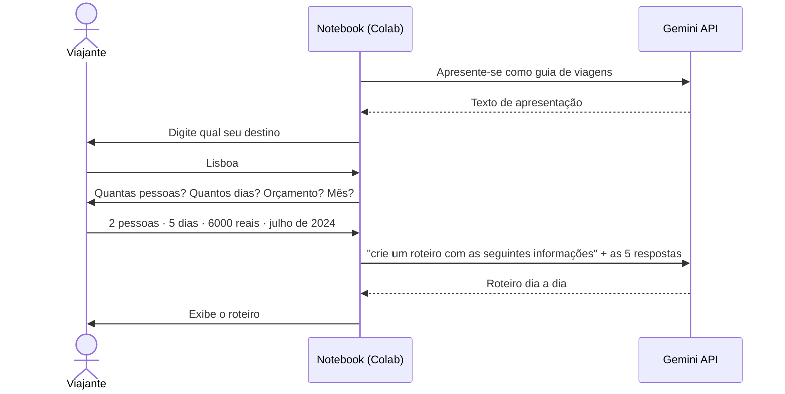

# Roteiro de viagem com Gemini

> **EN:** A 2024 Colab notebook from my first contact with LLM APIs: it collects a traveller's
> destination, group size, length of stay, budget and month, and asks Google Gemini for a tailored
> itinerary. Kept as a learning record; the model it targets (`gemini-1.0-pro`) has since been retired.

Notebook feito na **Imersão IA, em maio de 2024**, meu primeiro projeto usando a API de um LLM. O
usuário responde a cinco perguntas no terminal e o Gemini devolve um roteiro de viagem montado com
essas informações.

## Como funciona

| Etapa | Detalhe no código |
|---|---|
| Configuração | `google-generativeai`, chave lida dos *Secrets* do Colab (`userdata.get`) |
| Modelo | `gemini-1.0-pro`, `temperature=0.5`, `candidate_count=1` |
| Coleta | Cinco `input()` empilhados numa lista, que vai inteira como prompt |
| Geração | Uma chamada de `generate_content` com a lista |

## Como rodar

1. Abra o notebook no Colab pelo botão acima.
2. Gere uma chave em [Google AI Studio](https://aistudio.google.com/) e salve-a nos **Secrets** do
   Colab (ícone de chave na barra lateral).
3. Troque `"COLOQUE_SUA_API_KEY"` pelo nome que você deu ao secret.
4. **Troque `gemini-1.0-pro` por um modelo atual** (veja a lista em `genai.list_models()`), porque o
   1.0 Pro foi descontinuado.
5. Execute a célula e responda às perguntas.

## O que eu faria diferente hoje

Deixei o código como foi escrito, porque ele registra o ponto de partida. Revendo dois anos depois:

- **O roteiro é só texto gerado.** O modelo não consulta preço, disponibilidade nem clima, então o
  orçamento é só uma sugestão no prompt. Hoje eu usaria *tool calling* com APIs reais de voos e
  hospedagem.
- **Prompt solto.** As respostas vão como itens de uma lista, sem instrução de formato. Um prompt de
  sistema com a estrutura esperada (dia, manhã, tarde, noite, custo estimado) tornaria a saída
  previsível.
- **Filtros de segurança desligados** (`BLOCK_NONE` nas quatro categorias). Isso não é necessário
  para este caso de uso e não deveria ser o padrão.
- **Saída pelo "fim" incompleta.** Se o destino digitado for `fim`, o notebook imprime "obrigado",
  mas depois ainda imprime `Resposta:` com o texto de apresentação gerado no início.
- **Código morto:** o `start_chat` cria um histórico que nunca recebe mensagens, então o bloco
  "Histórico do chat" imprime vazio.

## Stack

Python · Google Colab · Gemini API (`google-generativeai`)
